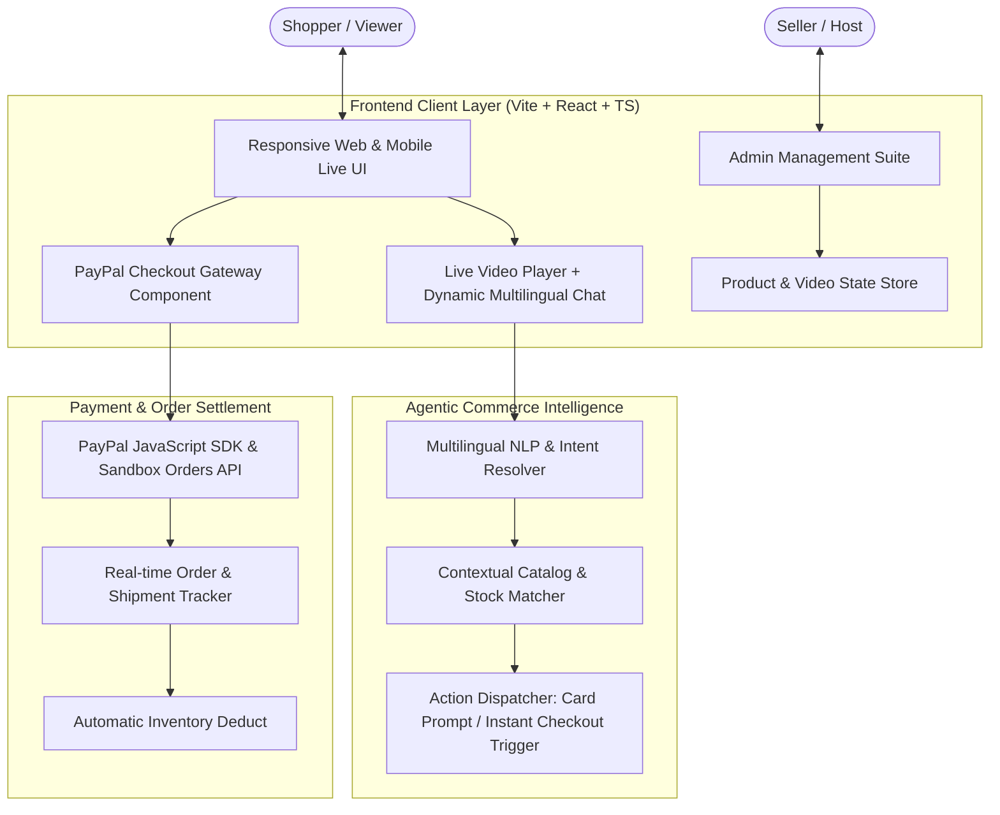

# 🛍️ PayPal AI Live Commerce - Agentic Shopping Platform

> **Hackathon Submission**: PayPal AI Commerce Hackathon 2026  
> **Target Category**: Best Use of Agentic Commerce / Best Use of PayPal + AI  
> **Production Live URL**: [https://vmall.cafeblanc.kr](https://vmall.cafeblanc.kr)  
> **Official YouTube Demo Video**: [https://youtu.be/TYfW_2lSGD4](https://youtu.be/TYfW_2lSGD4)  
> **GitHub Repository**: [https://github.com/cafeblanc/paypal-ai-hackathon](https://github.com/cafeblanc/paypal-ai-hackathon)

---

## 📌 Executive Summary

**PayPal AI Live Commerce** is a real-time, interactive live commerce platform powered by an **autonomous Agentic Commerce engine** and the **PayPal Developer Platform (Sandbox)**.

While watching live seller broadcasts, shoppers interact with an intelligent shopping agent in **6 global languages** (English, Korean, Japanese, Chinese, Spanish, French). The agent understands user queries, dynamically suggests matching products directly inside the chat stream, and seamlessly launches a **compact, one-click PayPal checkout experience** without redirecting away from the live broadcast.

---

## 📺 Official YouTube Demo Video

Watch the full 100-second interactive hackathon demonstration showing real-time streaming, AI Shopping Agent chat, PayPal Sandbox virtual checkout inputs, dynamic live stream video switching, and the full Seller Admin Portal walkthrough:

👉 **[Watch Demo on YouTube: https://youtu.be/TYfW_2lSGD4](https://youtu.be/TYfW_2lSGD4)**

[](https://youtu.be/TYfW_2lSGD4)

---

## 🎬 Architecture & System Design



---

## 🚀 Key Features

### 1. 🤖 Autonomous Agentic Commerce Workflow
- **Conversational Buying**: Users can simply type *"I want to buy the honey"* or *"결제할게요"*, and the AI agent automatically recognizes intent, checks real-time inventory, and displays an instant checkout card.
- **Multilingual AI Responses**: Real-time localized interactions in English, 한국어, 日本語, 中文, Español, and Français with concise `🤖` bot feedback.
- **In-stream Instant Purchase**: Buyers do not need to leave the stream or go to external shopping cart pages; the order executes immediately inside the broadcast viewer.

### 2. 💳 PayPal Developer Platform Integration
- **Direct PayPal Sandbox Gateway**: Integrated with PayPal Orders API to process transactions securely in real-time.
- **Mobile-Optimized Checkout**: Compact 2-line shipping confirmation UI tailored specifically for mobile and web screens, preventing clipped payment buttons.
- **Live Order & Tracking Confirmation**: Immediately generates simulated PayPal Transaction IDs (`PAYID-...`) and local courier tracking numbers with real-time stock sync.

### 3. 📱 Mobile First & High Performance
- **Zero-Latency Video Playback**: Fully compliant with mobile browser autoplay policies (`muted` auto-start with top-right unmute toggle).
- **Adaptive Fallback Video**: Guarantees non-stop live video playback with resilient CDN failover streams.
- **Full Seller Admin Portal**: Complete catalog management suite allowing sellers to register products, switch live demo feeds, adjust stock, and designate default startup videos.

---

## 🛠️ Technology Stack

- **Frontend**: React 18, TypeScript, Tailwind CSS, Vite
- **Payment & Fintech**: PayPal JavaScript SDK / PayPal Orders Sandbox API
- **State & Storage**: Resilient Local Storage Seeding & Sync
- **Deployment**: Vercel Cloud Platform (CI/CD)

---

## 💻 Getting Started Locally

### Prerequisites
- Node.js (v18 or higher)
- npm or pnpm

### 1. Clone & Install
```bash
git clone https://github.com/cafeblanc/paypal-ai-hackathon.git
cd paypal-ai-hackathon
npm install
```

### 2. Environment Setup
Create a `.env` file in the root directory:
```env
VITE_PAYPAL_CLIENT_ID=your_paypal_sandbox_client_id_here
```

### 3. Run Development Server
```bash
npm run dev
```

### 4. Build for Production
```bash
npm run build
```

---

## 🔒 Security & Compliance
- **Zero Secret Exposure**: All sandbox API credentials and sensitive host environment variables are strictly ignored in `.gitignore` and excluded from repository commits.
- **Client-Side Safety**: Compliant with standard PCI-DSS / PayPal SDK client token policies.

---

## 📄 License
This project is licensed under the MIT License - built for the **PayPal AI Hackathon**.
